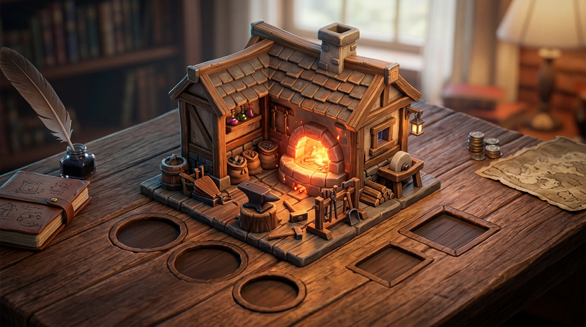

# ⚒️ Huyền Thoại Lò Rèn — Legend of the Forge

<p align="center">
  
</p>

<p align="center">
  <b>Trò chơi mô phỏng công xưởng rèn thần binh kết hợp cơ chế Clicker / Idle Tycoon trên nền tảng Unity 6</b><br>
  <i>Phát triển & Kiến trúc bởi <b>Trường Giang</b></i>
</p>

<p align="center">
  
  
  
  
  
  
</p>

---

## 📖 1. Giới Thiệu Dự Án

**"Huyền Thoại Lò Rèn" (Legend of the Forge)** đưa người chơi vào vai một bậc thầy thợ rèn Dwarven cổ đại sâu trong lòng núi đá ngầm. Bắt đầu từ một chiếc đe thô sơ và lò than hồng, người chơi từng bước chế tác trang bị, thu hoạch quặng thần binh, tự động hóa dây chuyền máy móc và mở rộng quy mô xưởng rèn để vươn tới danh hiệu **Đại Sư Thần Binh**.

Trò chơi được phát triển theo tiêu chuẩn kỹ thuật hiện đại của **Unity 6**, áp dụng mô hình **Human-in-the-Loop** kết hợp Hệ sinh thái **Multi-AI chuyên biệt hóa cao độ** (Gemini 3.8, Claude 4.6, Grok Premium, Suno AI).

---

## ✨ 2. Tính Năng Nổi Bật

- 🔨 **Tương Tác Đe Rèn 3D & Búa Rèn Động (Interactive 3D Smithing):** 
  - Mô hình **Đe Rèn 3D Sử Thi** điêu khắc tỉ mỉ với đế gỗ sồi cổ thụ, đai sắt gia cố, mặt đe thép tôi bóng loáng và thỏi phôi quặng nóng đỏ phát quang (`Hot_Ingot`).
  - **Búa Rèn 3D Tương Tác (`HammerVisual3D.cs`)**: Cán gỗ, đầu búa bát giác hắc thiết tự động vung đập giáng xuống đe `CLANG!` kèm độ nảy đàn hồi (*rebound damping*) và tia lửa phát sáng mỗi lần người chơi nhấp chuột.
- 🔥 **Lò Nung Đá Vòm 3D & Chiếu Sáng Động (Dynamic 3D Hearth):**
  - Cấu trúc lò nung đá vòm cong 3D (`Stone_Furnace`) với lòng than củi cháy rực (`Furnace_Fire`), ống khói vương miện sắt.
  - Đèn URP Point Light đặt trực tiếp trong buồng lửa, tỏa ánh sáng vàng cam chân thực lên bề mặt gỗ và đe rèn theo thời gian thực.
- ⚙️ **Hệ Thống 5 Thế Hệ Máy Móc 3D Cơ Khí Riêng Biệt (Procedural 3D Machinery):**
  - `G1: Búa Tí Hon (Tiny Hammer)` — Trụ gỗ sồi, bánh răng cam và cánh tay đòn búa gõ tự động mini.
  - `G2: Xe Khoan Quặng (Ore Drill)` — Xe goòng 4 bánh sắt, giá đỡ xoắn ốc và mũi khoan quặng góc xiên.
  - `G3: Lò Luyện Kim 3D (Coal Smelter)` — Chân kiềng 3 chạc hắc thiết đỡ nồi nấu kim loại bằng đồng rực sáng.
  - `G4: Cối Xay Hơi Nước (Steam Mill)` — Bệ máy gang, bánh đà đồng khổng lồ, xi lanh piston và đồng hồ đo áp suất.
  - `G5: Golem Thợ Rèn Tự Hành (Master Automaton)` — Robot Dwarven với chân trụ, giáp ngực, lõi ma thuật phát sáng, mũ visor, cầm kìm kẹp và búa tạ.
- 📐 **Hiệu Ứng Thị Sai Chiều Sâu 3D (3D Camera Parallax):**
  - Camera URP tự động xoay nghiêng mượt mà theo tọa độ chuột (`CameraParallax3D.cs`), tôn lên độ sâu không gian 3 chiều và bóng đổ thực của xưởng rèn.
- ⚒️ **Hệ Thống Nâng Cấp Búa Rèn & Lò Nung (Tools & Forge Upgrades):**
  - **Búa Rèn Thần Binh (`UP_HAMMER`):** Gia tăng uy lực mỗi cú đập (*Tap Power*), mở rộng sản lượng quặng khai thác tức thời.
  - **Lò Nung Nhiệt Hạch (`UP_FURNACE`):** Tăng theo % toàn bộ tổng sản lượng công xưởng + Cường hóa ánh sáng Point Light 3D rực lửa theo cấp độ.
  - **Găng Tay Da Rồng (`UP_GLOVES`):** Kích hoạt tỷ lệ Bạo Kích (*Critical Strike* x5 Quặng) hiển thị chữ nổ Ruby rực lửa `💥 CRIT!`.
  - **Dầu Tôi Huyền Bí (`UP_OIL`):** Gia tăng tốc độ khai thác tự động của toàn bộ dàn máy móc (+15% DPS/cấp).
- 🛒 **Cửa Hàng Công Xưởng 2 Tab Chuyên Biệt (Two-Tab Workshop UI):**
  - **Tab 1: ⚙️ DÂY CHUYỀN MÁY MÓC (G1..G5)** — Mua sắm và nâng cấp các trạm máy tự động hóa từ *Tay Búa Tí Hon* đến *Robot Thợ Cả*.
  - **Tab 2: 🔨 BÚA & LÒ NUNG (Tools & Forge)** — Nâng cấp vũ khí thợ rèn, cường hóa lò nhiệt hạch và kích hoạt bạo kích.
- 🏺 **Đạo Cụ Xưởng Rèn 3D Mở Khóa Theo Cột Mốc (Milestone 3D Props):**
  - Giá để quặng pha lê 3D phát sáng đa diện (`Decor_OreShelf`), Rương kho báu mở nắp lộ các thỏi vàng 3D (`Decor_Chest`), Ống xả khói đồng (`Decor_SmokeStack`) và Bảng hiệu xưởng rèn cổ (`Decor_Sign`).
- 📈 **Đường Cong Kinh Tế Lũy Tiến:** Cân bằng toán học chuẩn xác $\text{Cost}(n) = \text{BaseCost} \times (1.15)^n$ cùng các mốc đột phá (*Milestone Multipliers*) x2, x4 giữ chân người chơi.
- 🏆 **8 Cấp Bậc Danh Hiệu Sử Thi:** Từ *Tập Sự (Apprentice)* đến *Đại Sư Thần Binh (Grandmaster Smith)*.
- 🌐 **Hỗ Trợ Song Ngữ (VI / EN):** Chuyển đổi ngôn ngữ Tiếng Việt và Tiếng Anh thời gian thực thông qua hệ thống Hybrid Typography (Phôi nút kim loại kết hợp Dynamic Text).
- 🎵 **Âm Nhạc Nền Độc Quyền (OST):** Bản nhạc chủ đề *"Dwarven Forge Pulse"* (95 BPM, D-Dorian, nhịp đe búa dân gian Bắc Âu lặp mượt mà).
- 🛡️ **Lưu Trữ An Toàn & Sao Lưu Kép:** Quản lý dữ liệu JSON kèm cơ chế tự động tạo file dự phòng (`.bak`), đảm bảo 100% không mất tiến trình khi mất điện đột ngột.
- 📱 **Hỗ Trợ Đa Khung Hình (Responsive Layout):** Tự động thích ứng cả màn hình ngang (*Landscape 16:9*) và màn hình dọc (*Portrait*).
- 📦 **Đóng Gói 1-Click Standalone Windows:** Tích hợp bộ công cụ Editor `ForgeBuildTools.cs` biên dịch file `.exe` độc lập chỉ với 1 thao tác.

---

## 🤖 3. Hệ Sinh Thái Multi-AI Tích Hợp

Dự án không phụ thuộc vào một công cụ AI duy nhất mà phân bổ theo ma trận chuyên môn hóa:

| Công Cụ AI | Phiên Bản | Phân Hệ Đảm Nhiệm | Sản Phẩm Đầu Ra Thực Tế | Tỷ Lệ Đóng Góp |
| :--- | :---: | :--- | :--- | :---: |
| **Google Gemini** | **3.8 Agent** | **Lead Engineering & Unity Architecture** | Toàn bộ 15 scripts C#, tối ưu Raycast, giải quyết lỗi Canvas Sibling Index, viết tool đóng gói `ForgeBuildTools.cs`. | **45%** |
| **Anthropic Claude** | **4.6 Sonnet** | **Game Design & Lore Master** | Tài liệu GDD, công thức cân bằng kinh tế lũy tiến $1.15^n$, thiết kế 5 trạm máy, 8 danh hiệu thợ rèn, từ điển song ngữ. | **25%** |
| **xAI Grok** | **Premium** | **Concept Art & 2D UI Sprites** | Background lò rèn hắc thiết (`Tex_MainMenu_BG.jpg`), bộ 3 phôi nút kim loại rèn, concept art máy móc và đạo cụ xưởng. | **20%** |
| **Suno AI** | **Free Edition** | **Audio Director & Music Producer** | Bản nhạc nền độc quyền *Dwarven Forge Pulse.mp3* (95 BPM, 44.1kHz, 320 kbps, Seamless Loop). | **10%** |

> 📄 **Xem báo cáo chi tiết minh chứng AI:** Đọc file [TAI_LIEU_MINH_CHUNG_AI_GAME.md](TAI_LIEU_MINH_CHUNG_AI_GAME.md) hoặc [Tai_Lieu_Minh_Chung_AI_Game_Huyen_Thoai_Lo_Ren.docx](Tai_Lieu_Minh_Chung_AI_Game_Huyen_Thoai_Lo_Ren.docx).

---

## 📂 4. Cấu Trúc Thư Mục Dự Án

```
Forge/
├── Assets/
│   └── _Forge/
│       ├── Art/
│       │   ├── Audio/             # Bản nhạc nền Dwarven Forge Pulse.mp3
│       │   └── Textures/          # Background lò rèn, UI Buttons, Icons, Hero Anvil/Furnace
│       ├── Data/                  # ScriptableObject BalanceConfig & 5 Generators (G1-G5)
│       ├── Scenes/
│       │   └── ForgeDesk.unity    # Scene chính hoàn chỉnh của trò chơi
│       ├── Scripts/
│       │   ├── Audio/             # AudioService.cs
│       │   ├── Core/              # GameManager.cs, LocalizationService.cs, SettingsService.cs...
│       │   ├── Economy/           # EconomyService.cs, MilestoneService.cs
│       │   ├── Editor/            # ForgeBuildTools.cs, ForgeSetupTools.cs
│       │   ├── FX/                # CameraPunch.cs, ForgeLightController.cs
│       │   ├── Save/              # SaveService.cs, OfflineService.cs, SaveData.cs
│       │   ├── UI/                # MainMenuView.cs, SettingsView.cs, HudView.cs, ShopView.cs...
│       │   └── World/             # ClickForge.cs, FurnaceVisual.cs, OrientationManager.cs...
│       └── Settings/URP/          # URP Asset, Universal Renderer & Volume Profile
├── Packages/                      # Manifest quản lý package Unity 6
├── ProjectSettings/               # Cấu hình PlayerSettings (Đứng tên Trường Giang)
├── .gitignore                     # Cấu hình loại trừ cache Library/Builds
├── README.md                      # Tài liệu tổng quan dự án
├── TAI_LIEU_MINH_CHUNG_AI_GAME.md # Báo cáo minh chứng AI chi tiết (Markdown)
└── Tai_Lieu_Minh_Chung_AI_Game_Huyen_Thoai_Lo_Ren.docx # Báo cáo minh chứng AI (Word có hình)
```

---

## 🚀 5. Hướng Dẫn Cài Đặt & Chạy Game

### Yêu Cầu Môi Trường:
- **Unity Hub** và **Unity 6 (phiên bản 6000.5.4f1 hoặc Unity 6 LTS bất kỳ)**.
- Hệ điều hành: Windows 10/11 64-bit.

### Các Bước Thực Hiện:
1. **Clone repository về máy:**
   ```bash
   git clone https://github.com/Tunglofichill/anhgiangcms.git
   ```
2. **Mở dự án trong Unity Hub:**
   - Mở Unity Hub ➔ Chọn **Add** (Thêm dự án từ đĩa) ➔ Trỏ vào thư mục vừa clone.
   - Chọn Editor version **Unity 6**.
3. **Chạy game trong Editor:**
   - Trong cửa sổ Project, mở Scene: `Assets/_Forge/Scenes/ForgeDesk.unity`.
   - Bấm nút **Play (Ctrl + P)** để bắt đầu chơi.
4. **Đóng gói ra file chạy Windows (.exe):**
   - Trên thanh menu của Unity Editor, chọn:
     `Forge` ➔ `Build Standalone Windows (x64)`
   - Quá trình biên dịch sẽ tự động diễn ra và xuất file thực thi tại:
     `Builds/Windows/LegendOfTheForge.exe`.

---

## 👤 6. Tác Giả & Bản Quyền

- **Tác giả / Nhà phát triển:** **Trường Giang**
- **Dự án:** Huyền Thoại Lò Rèn *(Legend of the Forge)*
- **Học phần:** Đồ án Game — Giai đoạn 2 (Báo cáo sản phẩm & Minh chứng ứng dụng AI)
